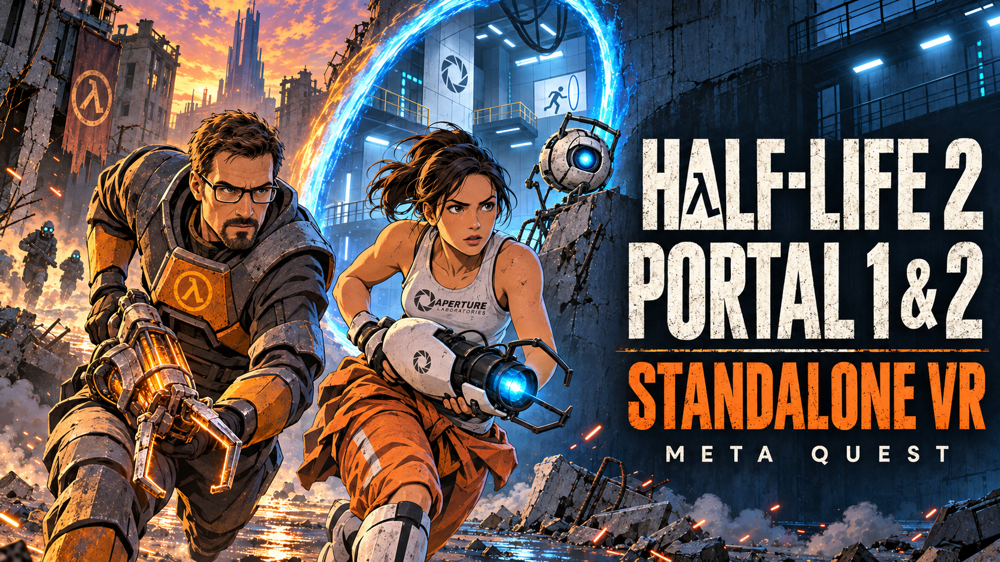

# Half-Life 2 & Portal — Standalone VR

[Русская версия](README.ru.md) · **[Download the latest APK](https://github.com/alferiko/half-life-2-stanalone-quest-releases/releases/latest)** · [What's new in 1.01](RELEASE_NOTES_1.01.md) · [Report an issue](https://github.com/alferiko/half-life-2-stanalone-quest-releases/issues)

An unofficial, free, non-commercial standalone VR adaptation for **Meta Quest 3 and Quest 3S**. One APK supports **Half-Life 2, Episode One, Episode Two, Lost Coast, Portal and Portal 2**. You must own the games on Steam; buying this port is not required.

**Install the APK, then download your games from Steam in the headset launcher.** Current Steam content, including the Half-Life 2 Anniversary update, is supported. A pre-Anniversary/Legacy version is no longer required. A PC cache build is an optional fallback, not the normal installation process.

## Contents

- [Requirements](#requirements)
- [Install and launch](#install-and-launch)
- [Controls](#controls)
- [Graphics and comfort](#graphics-and-comfort)
- [Updates, saves and backups](#updates-saves-and-backups)
- [Optional PC cache builder](#optional-pc-cache-builder)
- [Troubleshooting](#troubleshooting)
- [Sending logs and bug reports](#sending-logs-and-bug-reports)
- [Credits and support](#credits-and-support)

## Requirements

- Meta Quest 3 or Quest 3S with Developer Mode enabled and Touch controllers.
- A legal Steam account owning the games you want to play; install only the campaigns offered for your library.
- Wi-Fi on the headset and enough free storage for game downloads, temporary installation files and prepared VR resources. The APK alone is about 752 MB; game content is additional.
- A sideloading tool for the APK. The USB instructions below use a computer, a data cable and [Android Platform Tools](https://developer.android.com/tools/releases/platform-tools).

Games run locally on the headset. A gaming PC, PC VR streaming and a local Steam installation are not required for the built-in Steam download method.

## Install and launch

### 1. Install the APK

Download **`hl2quest-vr.apk`** from [Releases](https://github.com/alferiko/half-life-2-stanalone-quest-releases/releases/latest). Connect the headset and accept its USB debugging prompt, then run:

```bash
adb devices
adb install -r hl2quest-vr.apk
```

`-r` updates the existing app without uninstalling it. Start **Half-Life 2 VR Standalone** from the headset's **Unknown Sources** apps. Grant the storage permissions requested by the launcher so it can use `/sdcard/srceng`.

### 2. Download games inside the launcher

1. Choose the desired game and language in the launcher. For a campaign without installed data, use **Check cache** to open Steam sign-in.
2. Sign in with the Steam account that owns the game. Complete Steam Guard in the phone app or enter the requested email/app code. The launcher does not save your password.
3. Select one game or **Download all** from the supported games available in your library.
4. Wait for downloading, file verification and VR resource preparation to finish. After selecting games, you can minimize the launcher; return to it if Steam Guard or another prompt needs attention.
5. Select the campaign and press **Launch game**. Allow any first-launch resource preparation to complete. Later, use **Continue game** or the save manager.

Interrupted downloads retain downloaded files for a retry. Keep enough free space and avoid deleting the download folders while installation is running. Portal and Portal 2 can be installed separately from Half-Life 2.

### 3. First VR session

Put on the headset and make sure both controllers are tracked. Set your leading hand and comfort options in **VR and controls**; use **Apply** where offered. For seated play, enable seated mode and hold **X+Y** to calibrate height and centre. Restart the game after changing launcher graphics or VR settings that apply on launch.

## Controls


The table shows the default right-handed layout. Choose Left (mirrored) in the launcher to mirror weapon-hand actions. Custom button assignments override this table.

| Touch controller input | Action |
|---|---|
| Left thumbstick | Move; forward direction follows horizontal head direction |
| Right thumbstick | Turn/look; smooth or snap turning is selectable in the launcher |
| Dominant-hand trigger (right by default) | Fire; point and select in menus |
| Support-hand trigger | Orange portal with the portal gun; mounted-gun fire or buggy boost with alternative vehicle controls |
| Either grip | Grab/use with a free hand; the dominant grip provides weapon-specific actions while holding a weapon |
| A | Jump; confirm in menus |
| B | Tap/hold weapon selection; back in menus |
| X | Reload; eject magazine/ammunition during physical reload |
| Y | Flashlight |
| Left thumbstick click | Toggle sprint |
| Right thumbstick click | Toggle crouch |
| Menu button on the left controller | Open or close the pause menu |

### VR interactions

- **Weapon selection:** tap B to switch quickly; hold B, point at a weapon in the radial/grid selector, then release. In left-handed mode this role moves to Y.
- **Physical reload (default):** eject the current magazine/ammunition with X for a right-handed profile (A when left-handed), reach behind the shoulder with the free hand to take fresh ammunition, insert it and operate the slide/pump where required. Reload mode can be changed in launcher settings.
- **Two-handed weapons:** hold the free-hand grip near the fore-end to attach the second hand; release it to detach.
- **Alternate fire:** for an armed weapon, double-squeeze the dominant grip within 350 ms. The gravity gun uses its dominant grip to attract/release and its trigger to punt.
- **Objects and controls:** grip starts and maintains use with the hand that touched the object. This also works for continuously operated levers and wheels.
- **Physical ladders:** when enabled, place either hand near a rung, hold that hand's grip and pull down. Either hand can remain attached; release both grips to dismount.
- **Crowbar:** physical-contact damage is optional. When enabled, swing the crowbar; trigger attack remains available when the option is disabled.
- **Mounted guns:** grab the handles, fire with either trigger and release either grip to let go.
- **Vehicles:** the optional alternative layout uses the physical left stick for throttle/brake, the right stick for steering and the non-dominant trigger for buggy boost.
- **Room-scale movement:** optional and disabled by default; enable it in the launcher if you want real horizontal body motion to add locomotion.

### Portal and Portal 2

With the portal gun, the **leading-hand trigger fires the blue portal** and the **support-hand trigger fires the orange portal**, once the corresponding portal is available in the story. Both grips remain available for grabbing/using objects. The HL2 double-grip alternate-fire gesture does not fire the orange portal.

### Remapping and comfort

In **VR and controls → Button layout**, A/B/X/Y and both stick clicks can be reassigned to jump, weapon selection, reload, flashlight, sprint, crouch or disabled. Menu inputs and calibration chords remain unchanged. Choose **Immersive** or **Comfortable** as a starting preset, then adjust individual options and apply them.

Continuous locomotion and Blink teleport, smooth/snap turns, seated mode and physical crouch are configurable. Camera-based finger tracking is optional for HL2 and the episodes; it animates fingers while gameplay still uses the controllers.

## Graphics and comfort

Graphics settings are stored per campaign. **Hybrid (Vulkan)** is available for all six campaigns. **Classic (OpenGL)**, also called GLES/Turbo in development reports, is available for HL2, Lost Coast and the episodes; Portal and Portal 2 use Vulkan.

Start with the supplied settings. If needed, reduce per-eye resolution or graphics quality and change one option at a time. Anniversary compatibility is enabled by default; **Smooth Anniversary lighting** can be disabled for performance without disabling content compatibility. Full campaign performance varies by scene and settings; the release smoke check is not a performance benchmark.

## Updates, saves and backups

Install the new APK over the existing version with `adb install -r hl2quest-vr.apk`, or use the launcher's update check and confirm Android's installer. Do not uninstall the app or clear its data as a routine update step. If Android reports a signature mismatch, keep the current installation and back up your data before troubleshooting.

Existing game data does not need a blanket rebuild for 1.01: the launcher prepares the bundled VR resources. Save folders live at `/sdcard/srceng/<campaign>/save`, with campaign directories `hl2`, `episodic`, `ep2`, `lostcoast`, `portal` and `portal2`. Settings are also stored in each campaign's `cfg` folder and in the launcher.

For a complete shared-storage backup, close the game and copy the tree to a new folder on your computer:

```bash
adb pull /sdcard/srceng ./HL2Quest-backup
```

This includes game data, saves, configs and mods, but not Android-private launcher preferences. A smaller backup can copy each installed campaign's `save` and `cfg` directories instead. Do not delete or replace the whole `srceng` tree to resolve a single issue. Save-file preservation during update does not guarantee every old save is compatible with changed game content.

## Optional PC cache builder

The existing **`BUILD_GAME_CACHE.bat` / `BUILD_GAME_CACHE.sh`** scripts remain an auxiliary way to prepare locally installed Steam content. They are the older **0.989 helper**, cover HL2/Lost Coast/episodes/Portal 1, and **do not build Portal 2 content**. They are not required by 1.01 and have not been revalidated against every current Steam depot. Prefer the built-in downloader, especially for Portal 2.

If you need the helper:

1. Clone/download this repository, keeping `BUILD_GAME_CACHE.*`, `tools/`, `vr_game_resources/` and `vr_game_resources/MANIFEST.sha256` together.
2. Run `BUILD_GAME_CACHE.bat` on Windows, or `bash BUILD_GAME_CACHE.sh` on Linux (Bash 4+ and GNU coreutils).
3. Select your legally installed Half-Life 2 root containing `hl2` and `platform`; optionally provide the Portal root. The helper detects installed episodes and Lost Coast. There is no requirement to switch Steam to a pre-Anniversary branch.
4. Back up existing headset data before transferring the generated tree:

   ```bash
   adb push game_cache/srceng /sdcard/
   ```

5. Open the current launcher and allow its resource preparation to finish. If the older helper cannot process your installation, use Steam download in the launcher.

The path must be `/sdcard/srceng/hl2` (or the chosen campaign), not `/sdcard/srceng/srceng/hl2`. This helper builds a **game-data cache**, not an APK.

## Troubleshooting

- **`adb devices` says `unauthorized`:** put on the headset and accept the computer's USB debugging fingerprint. With several devices, add `-s DEVICE_SERIAL` after `adb`.
- **Campaign not installed:** select it and use **Check cache**; confirm Steam ownership and finish the download. Do not copy only `gameinfo.txt` to make a campaign appear installed.
- **Steam installation fails:** check free space, connection and Steam Guard, then retry. Include `steam-install-error.txt` with your report if it exists.
- **Black screen or return to the launcher:** collect logs immediately, before repeated launches overwrite the engine log. Record the selected campaign and renderer. Try without user mods after backing up their configuration.
- **Wrong height or floor:** check seated/standing mode and hold X+Y to recalibrate.
- **Poor frame rate:** lower graphics settings or per-eye resolution; for HL2 content, compare Vulkan and Classic. Portal campaigns require Vulkan.

## Sending logs and bug reports

### What to include

Open a [GitHub issue](https://github.com/alferiko/half-life-2-stanalone-quest-releases/issues/new) or contact **antonregolitov@gmail.com** (also shown in the launcher's About page). Include:

- APK version, Quest model and headset OS version;
- game/campaign, map or chapter, renderer and important graphics/VR settings;
- exact steps, expected result and what happened; whether it repeats;
- whether content came from the launcher or PC helper, selected language and any mods;
- logs, a screenshot/video, and a relevant save if needed to reproduce the issue.

### Collect logs over USB

Immediately after reproducing the issue, before launching another game:

```bash
adb pull /sdcard/srceng/engine.log ./engine.log
adb logcat -d -v threadtime > logcat.txt
adb logcat -d -b crash -v threadtime > crash.txt
adb shell dumpsys activity exit-info com.valvesoftware.source.vrtest > exit-info.txt
```

For a Steam installation failure, also copy this file if present:

```bash
adb pull /sdcard/srceng/steam-install-error.txt ./steam-install-error.txt
```

If the problem happens before `engine.log` is created, send the other logs. For a fresh live capture, run `adb logcat -v threadtime > logcat-live.txt`, reproduce the problem, then press **Ctrl+C** on the computer. ZIP the text files and attach them to the report. Logs can contain device/account identifiers and activity from other apps: review them before posting publicly. Never include Steam passwords, Guard codes or session tokens.

## Credits and support

Included models, materials, icons and fonts belong to their respective authors. See [included-mod credits](RELEASE_NOTES_1.01.md#credits--авторы) for Juniez Weapons Pack, PortalGun HD Remake, Gordon and Chell models, icons and fonts. Thanks to Valve, nillerusr and contributors, hl2mp/d3d9-vr contributors, Volkolak, JersonGaming, Dynamic_, Just Jacob, LarrySBM, Khronos, Meta and community testers.

[Support development on Patreon — zer0k0](https://www.patreon.com/cw/zer0k0)

Ethereum: `0xefFcAc44B2dc16333745fAC2df39218BBE7e341F`

This is an unofficial, non-commercial project, not affiliated with Valve or Meta. Commercial game depots must be obtained through your own Steam licences; the APK is not a replacement for buying the games. Half-Life, Portal, Steam, Source and Meta Quest trademarks belong to their respective owners.
