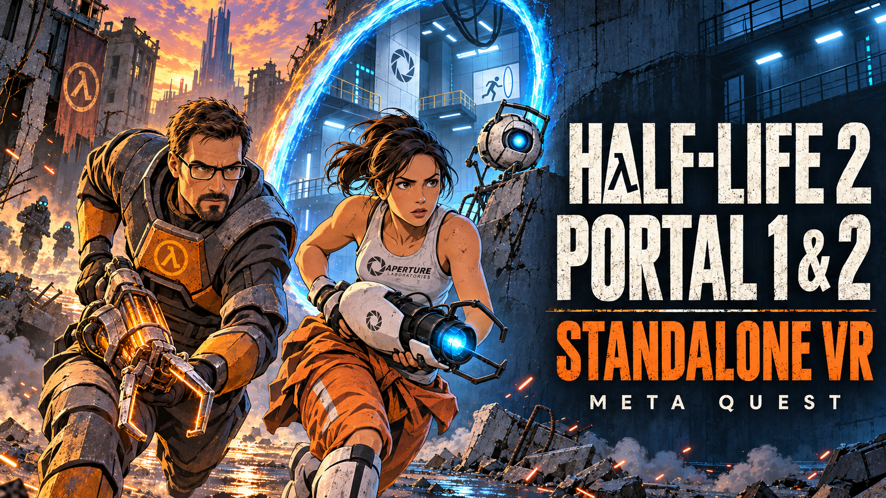

# HL2Quest — Half-Life 2, Portal и Portal 2 в VR для Meta Quest

[English version](README.md) · **[Скачать актуальный APK](https://github.com/alferiko/half-life-2-stanalone-quest-releases/releases/latest)** · [Что нового в 1.02](RELEASE_NOTES_1.02.md#русский) · [Сообщить о проблеме](https://github.com/alferiko/half-life-2-stanalone-quest-releases/issues)

**1.02 — исправление загрузки из Steam:** при временной ошибке DNS на Android загрузчик повторяет запрос. Обновляйте поверх своей редакции приложения; кеш и скачанные части файлов можно использовать повторно. [Подробности и инструкция](RELEASE_NOTES_1.02.md#русский).

**HL2Quest** — неофициальная бесплатная некоммерческая адаптация **Half-Life 2 VR, Portal VR и Portal 2 VR** для автономной игры на **Meta Quest 3 и Quest 3S**. Один Android APK поддерживает **Half-Life 2, Episode One, Episode Two, Lost Coast, Portal и Portal 2**. Игры должны быть приобретены в Steam; покупать сам порт не нужно.

**Установите APK, затем скачайте свои игры из Steam прямо в лаунчере на шлеме.** Поддерживаются актуальные ресурсы Steam, включая Anniversary-обновление Half-Life 2. Версия до Anniversary / ветка Legacy больше не требуется. Сборка кеша на ПК — вспомогательный вариант, а не основной способ установки.

## Содержание

- [Что потребуется](#что-потребуется)
- [Установка и первый запуск](#установка-и-первый-запуск)
- [Управление](#управление)
- [Графика и комфорт](#графика-и-комфорт)
- [Обновление, сохранения и резервные копии](#обновление-сохранения-и-резервные-копии)
- [Вспомогательный сборщик кеша на ПК](#вспомогательный-сборщик-кеша-на-пк)
- [Решение проблем](#решение-проблем)
- [Как отправить логи и сообщить об ошибке](#как-отправить-логи-и-сообщить-об-ошибке)
- [Частые вопросы](#частые-вопросы)
- [Авторы и поддержка](#авторы-и-поддержка)

## Что потребуется

- Meta Quest 3 или Quest 3S с включённым режимом разработчика и контроллерами Touch.
- Собственный Steam-аккаунт с приобретёнными играми; устанавливайте кампании, доступные для вашей библиотеки.
- Wi-Fi на шлеме и свободное место для загрузки игр, временных файлов установки и подготовленных VR-ресурсов. Сам APK занимает около 752 МБ; игровые данные требуют дополнительного места.
- Программа для установки APK. Для команд ниже нужны компьютер, USB-кабель передачи данных и [Android Platform Tools](https://developer.android.com/tools/releases/platform-tools).

Игры работают на самом шлеме. Для встроенной загрузки из Steam не нужны игровой ПК, стриминг PC VR или локальная Steam-установка игры.

## Установка и первый запуск

### 1. Установите APK

Скачайте **`hl2quest-vr.apk`** из [Releases](https://github.com/alferiko/half-life-2-stanalone-quest-releases/releases/latest). Подключите шлем, подтвердите в нём USB-отладку и выполните:

```bash
adb devices
adb install -r hl2quest-vr.apk
```

Ключ `-r` обновляет приложение поверх установленной версии. Откройте **Half-Life 2 VR Standalone** в разделе **неизвестных источников** на шлеме. Предоставьте запрошенный лаунчером доступ к файлам для работы с `/sdcard/srceng`.

### 2. Скачайте игры в лаунчере

1. Выберите игру и язык в лаунчере. Если данные кампании ещё не установлены, нажмите **«Проверить кеш»**, чтобы открыть вход в Steam.
2. Войдите в аккаунт, которому принадлежит игра. Подтвердите Steam Guard в приложении на телефоне либо введите запрошенный код из письма/приложения. Лаунчер не сохраняет пароль.
3. Выберите одну игру или **«Скачать всё»** из поддерживаемых игр вашей библиотеки.
4. Дождитесь загрузки, проверки файлов и подготовки VR-ресурсов. После выбора игр лаунчер можно свернуть; вернитесь в него, если потребуется Steam Guard или ответ на другой запрос.
5. Выберите кампанию и нажмите **«Запустить игру»**. Дождитесь подготовки ресурсов при первом запуске. Затем можно пользоваться **«Продолжить игру»** или менеджером сохранений.

При прерывании загрузки скачанные файлы остаются для повторной попытки. Следите за свободным местом и не удаляйте папки загрузки во время установки. Portal и Portal 2 можно установить отдельно от Half-Life 2.

### 3. Первый сеанс в VR

Наденьте шлем и убедитесь, что оба контроллера отслеживаются. Выберите ведущую руку и параметры комфорта в **«VR и управление»**, нажмите **«Применить»**, где предлагается. Для игры сидя включите сидячий режим и удерживайте **X+Y** для калибровки высоты и центра. После изменения настроек, применяемых при запуске, перезапустите игру.

## Управление


В таблице указана стандартная раскладка для правой ведущей руки. Выберите «Левая (зеркально)» в настройках ведущей руки, чтобы зеркально поменять действия. Пользовательские назначения кнопок имеют приоритет над этой таблицей.

| Кнопка Touch | Действие |
|---|---|
| Левый стик | Движение; направление вперёд следует горизонтальному повороту головы |
| Правый стик | Поворот/обзор; в лаунчере выбирается плавный или резкий поворот |
| Курок ведущей руки (по умолчанию правой) | Огонь; наведение и выбор в меню |
| Курок неведущей руки | Оранжевый портал с портальной пушкой; огонь из стационарного орудия или ускорение багги при альтернативном управлении |
| Любой Grip | Захват/использование свободной рукой; Grip ведущей руки с оружием выполняет специальные действия этого оружия |
| A | Прыжок; подтверждение в меню |
| B | Короткий/долгий выбор оружия; назад в меню |
| X | Перезарядка; выбросить магазин/боеприпас при физической перезарядке |
| Y | Фонарик |
| Нажатие левого стика | Включить или выключить бег |
| Нажатие правого стика | Включить или выключить приседание |
| Кнопка Menu на левом контроллере | Открыть или закрыть меню паузы |

### VR-взаимодействия

- **Выбор оружия:** короткое нажатие B переключает оружие; удерживайте B, наведите руку на сектор кругового/табличного селектора и отпустите для подтверждения. В леворуком режиме это действие переносится на Y.
- **Физическая перезарядка (по умолчанию):** для правой ведущей руки выбросьте магазин или боеприпас кнопкой X (для левой — A), свободной рукой достаньте новый боеприпас из-за плеча, установите его и при необходимости передёрните затвор либо цевьё. Режим перезарядки меняется в настройках лаунчера.
- **Двуручный хват:** поднесите свободную руку к цевью и удерживайте её Grip; отпустите Grip, чтобы разорвать хват.
- **Альтернативный огонь:** с оружием в ведущей руке дважды сожмите её Grip с интервалом не более 350 мс. У гравипушки Grip ведущей руки притягивает/отпускает предмет, а курок создаёт импульс.
- **Предметы и органы управления:** Grip начинает и продолжает взаимодействие именно той рукой, которой объект был захвачен. Поддерживаются удерживаемые рычаги и колёса.
- **Физические лестницы:** если опция включена, поднесите любую руку к перекладине, удерживайте Grip и тяните руку вниз. Можно поочерёдно менять руки; отпустите оба Grip для схода.
- **Монтировка:** физический урон от контакта включается отдельно. При включённой опции наносите удар взмахом; при выключенной сохраняется обычная атака курком.
- **Стационарные орудия:** возьмитесь за рукояти, стреляйте любым курком; отпустите Grip любой руки, чтобы выйти.
- **Транспорт:** альтернативная схема использует левый стик для газа/тормоза, правый — для поворота, а курок неведущей руки — для ускорения багги.
- **Румскейл-передвижение:** дополнительная опция, по умолчанию выключена; реальное горизонтальное движение тела добавляет виртуальное перемещение.

### Portal и Portal 2

С портальной пушкой **курок ведущей руки создаёт синий портал**, а **курок неведущей — оранжевый**, когда соответствующий портал уже доступен по сюжету. Оба Grip используются для захвата предметов и взаимодействий. Двойное нажатие Grip для альтернативного огня HL2 не создаёт оранжевый портал.

### Переназначение кнопок и комфорт

В **«VR и управление → Раскладка кнопок»** можно переназначить A/B/X/Y и нажатия обоих стиков на прыжок, выбор оружия, перезарядку, фонарик, бег, приседание либо отключить действие. Кнопки меню и комбинации калибровки не меняются. Выберите начальный пресет **«Иммерсивный»** или **«Комфортный»**, затем настройте отдельные параметры и примените их.

Настраиваются плавное перемещение и телепортация Blink, плавные/резкие повороты, сидячий режим и физический присед. Опциональное отслеживание пальцев камерами доступно для HL2 и эпизодов: оно анимирует пальцы, но управление остаётся на контроллерах.

## Графика и комфорт

Графические настройки хранятся отдельно для каждой кампании. **«Гибридный (Vulkan)»** доступен для всех шести кампаний. **«Классический (OpenGL)»**, также называемый GLES/Turbo в технических отчётах, доступен для HL2, Lost Coast и эпизодов; Portal и Portal 2 используют Vulkan.

Начните с настроек по умолчанию. При необходимости уменьшайте разрешение на глаз или качество графики, меняя по одному параметру. Совместимость Anniversary включена по умолчанию; **«Плавное освещение Anniversary»** можно выключить для повышения производительности без отключения совместимости ресурсов. Частота кадров зависит от сцены и настроек; базовая проверка релиза не является тестом производительности.

## Обновление, сохранения и резервные копии

Устанавливайте новый APK поверх старого командой `adb install -r hl2quest-vr.apk` либо через проверку обновлений лаунчера с подтверждением в установщике Android. Для обычного обновления не нужно удалять приложение или очищать его данные. При ошибке несовместимой подписи сохраните текущую установку и сделайте резервную копию перед дальнейшими действиями.

Для перехода на 1.01 не нужна обязательная полная пересборка имеющегося кеша: лаунчер подготавливает включённые VR-ресурсы. Сохранения находятся в `/sdcard/srceng/<кампания>/save`; каталоги кампаний: `hl2`, `episodic`, `ep2`, `lostcoast`, `portal`, `portal2`. Настройки также хранятся в `cfg` соответствующей кампании и в лаунчере.

Для полной копии общих игровых файлов закройте игру и скопируйте дерево в новую папку на компьютере:

```bash
adb pull /sdcard/srceng ./HL2Quest-backup
```

В копию попадут игровой кеш, сохранения, конфиги и моды, но не закрытые Android-настройки лаунчера. Для меньшей копии отдельно сохраните `save` и `cfg` каждой установленной кампании. Не удаляйте и не заменяйте весь `srceng` ради исправления одной ошибки. Сохранность файлов при обновлении не гарантирует совместимость любого старого сохранения с изменёнными игровыми ресурсами.

## Вспомогательный сборщик кеша на ПК

Полный архив ниже остаётся версии **1.01** и совместим с **1.02**, но содержит старый APK. Замените вложенный `hl2quest-vr.apk` на [APK 1.02](https://github.com/alferiko/half-life-2-stanalone-quest-releases/releases/download/1.02/hl2quest-vr.apk) перед установкой на шлем. Готовый кеш пересобирать не нужно. [Исправление Steam-загрузки и обновление до 1.02](RELEASE_NOTES_1.02.md#русский).

**`BUILD_GAME_CACHE.bat`** (Windows) и **`BUILD_GAME_CACHE.sh`** (Linux) собирают кеш из ваших легальных **актуальных ПК-установок Half-Life 2, Portal и Portal 2**. Для HL2 включаются установленные эпизоды и Lost Coast; для Portal 2 — DLC, каталог `update` и установленные локализации. Каждую игру можно выбрать отдельно.

Это дополнительный способ; основной остаётся загрузка из Steam на шлеме. Нужны **Python 3.10+** (только стандартная библиотека, без pip-пакетов) и **официальный APK релиза 1.01**. Сборщик берёт базовые VR-ресурсы из этого APK и проверяет их хеши; старый оверлей `vr_game_resources/` не используется.

1. Скачайте **[полный архив сборщика — 752 МБ](https://github.com/alferiko/half-life-2-stanalone-quest-releases/releases/download/1.01/HL2Quest-Cache-Builder-1.01-Full.zip)**. Распакуйте ZIP целиком и откройте папку `HL2Quest-Cache-Builder-1.01-Full`. В ней уже есть **`hl2quest-vr.apk` со всеми встроенными VR-ресурсами**: отдельно скачивать ресурсы или распаковывать APK не нужно. Оставьте APK рядом со скриптами и сохраните структуру папки `tools`. Python 3.10+ установите отдельно: Python и файлы Steam-игр в архив не входят.
2. Запустите `BUILD_GAME_CACHE.bat` в Windows или `bash BUILD_GAME_CACHE.sh` в Linux. Выберите игровые папки, **новую** папку результата и язык озвучки. Найденные библиотеки Steam предлагаются автоматически; `-` пропускает игру.
3. Дождитесь копирования, проверки комплектности VPK и проверки всех итоговых файлов по SHA-256. Существующая папка результата не удаляется и не объединяется с новой. Сохранения, пользовательские конфиги, моды `custom`, Workshop и бинарники ПК исключаются.
4. Сделайте резервную копию данных шлема, затем скопируйте полученную папку `srceng`:

   ```bash
   adb push game_cache/srceng /sdcard/
   ```

5. При необходимости установите/обновите включённый APK командой `adb install -r hl2quest-vr.apk`. Откройте **лаунчер 1.01**, разрешите доступ к файлам и дождитесь автоматической подготовки версионных VR-ресурсов: оружия, тел, шейдеров совместимости и интерфейса. Для локального кеша вход в Steam не требуется. Выберите кампанию и запустите её.

Правильный путь на шлеме — `/sdcard/srceng/<кампания>`. Не копируйте внешнюю папку `game_cache` и не запускайте движок напрямую до подготовки лаунчером. Этот скрипт собирает **игровой кеш, а не APK**. Он использует установленные на ПК версии и языки, не скачивает недостающие файлы и не проверяет владение играми в Steam.

[Подробная инструкция для полного архива, команды и решение проблем](docs/CACHE_BUILDER.md#полный-архив-пошагово). В запросе APK нажмите Enter, чтобы использовать включённый файл; для русской озвучки введите `russian` в запросе языка. Актуальный Anniversary поддерживается; откат на Legacy не нужен. Маленький архив только со скриптами и ZIP исходников GitHub **не содержат** APK и ресурсов.

## Решение проблем

- **`unauthorized` в `adb devices`:** наденьте шлем и подтвердите отпечаток компьютера. При нескольких устройствах добавьте после `adb` параметр `-s СЕРИЙНЫЙ_НОМЕР`.
- **Кампания не установлена:** выберите её, нажмите «Проверить кеш», проверьте владение игрой в Steam и завершите загрузку. Не копируйте один `gameinfo.txt`, чтобы имитировать установленную игру.
- **Ошибка установки из Steam:** проверьте место, соединение и Steam Guard, затем повторите попытку. Приложите `steam-install-error.txt`, если он появился.
- **Чёрный экран или возврат в лаунчер:** сразу соберите логи, пока последующие запуски не перезаписали журнал движка. Укажите кампанию и рендерер. Попробуйте без пользовательских модов, предварительно сохранив их настройки.
- **Неправильная высота или пол:** проверьте сидячий/стоячий режим и удерживайте X+Y для повторной калибровки.
- **Низкая частота кадров:** уменьшите графические настройки или разрешение на глаз; для HL2 и эпизодов сравните Vulkan и классический режим. Portal использует Vulkan.

## Как отправить логи и сообщить об ошибке

### Что написать

Создайте [Issue в GitHub](https://github.com/alferiko/half-life-2-stanalone-quest-releases/issues/new) либо напишите на **antonregolitov@gmail.com** (адрес также есть в разделе «О проекте» лаунчера). Укажите:

- версию APK, модель Quest и версию системы шлема;
- игру/кампанию, карту или главу, рендерер и важные настройки графики/VR;
- точные шаги, ожидаемый результат, фактическое поведение и повторяемость;
- способ установки контента — лаунчер или сборщик на ПК, язык и установленные моды;
- логи, скриншот/видео и, если нужно для воспроизведения, соответствующее сохранение.

### Как забрать логи через USB

Сразу после воспроизведения ошибки, до запуска другой игры:

```bash
adb pull /sdcard/srceng/engine.log ./engine.log
adb logcat -d -v threadtime > logcat.txt
adb logcat -d -b crash -v threadtime > crash.txt
adb shell dumpsys activity exit-info com.valvesoftware.source.vrtest > exit-info.txt
```

При сбое установки из Steam дополнительно скопируйте этот файл, если он есть:

```bash
adb pull /sdcard/srceng/steam-install-error.txt ./steam-install-error.txt
```

Если ошибка произошла до создания `engine.log`, отправьте остальные журналы. Для записи нового сеанса выполните `adb logcat -v threadtime > logcat-live.txt`, воспроизведите ошибку и нажмите **Ctrl+C** на компьютере. Упакуйте текстовые файлы в ZIP и приложите к сообщению. Логи могут содержать идентификаторы устройства/аккаунта и события других приложений: просмотрите их перед публичной отправкой. Не прикладывайте пароль Steam, коды Guard или токены сессии.

## Частые вопросы

### Можно ли играть в Half-Life 2 VR на Quest без игрового ПК?

Да. HL2Quest запускает игру на самом Quest 3 или Quest 3S. Установите Android APK через программу для sideload-установки, затем скачайте приобретённые игры Steam в лаунчере на шлеме. Стриминг PC VR не используется. См. [установку и первый запуск](#установка-и-первый-запуск).

### Поддерживается ли Portal 2 в автономном VR? Нужна ли установленная Half-Life 2?

Portal 2 входит в список поддерживаемых игр общего APK и устанавливается независимо от Half-Life 2. Portal 1 также можно установить отдельно. Нужна соответствующая игра в вашей библиотеке Steam; обе Portal-кампании используют Vulkan.

### Нужна ли Half-Life 2 Legacy или версия до Anniversary?

Нет. Версия 1.01 поддерживает актуальный контент Steam, включая Anniversary-обновление Half-Life 2. Лаунчер скачивает текущие игровые данные и автоматически подготавливает VR-ресурсы.

### HL2Quest бесплатный? Оригинальные игры входят в APK?

Порт бесплатный и некоммерческий. APK содержит сам порт и включённые VR-ресурсы; коммерческие игровые депоты загружаются по вашим лицензиям Steam. Скачивайте APK из [релизов проекта на GitHub](https://github.com/alferiko/half-life-2-stanalone-quest-releases/releases/latest).

## Авторы и поддержка

Модели, материалы, иконки и шрифты принадлежат своим авторам. В [списке авторов включённых модов](RELEASE_NOTES_1.01.md#credits--авторы) указаны Juniez Weapons Pack, PortalGun HD Remake, модели Gordon и Chell, иконки и шрифты. Благодарим Valve, nillerusr и участников, участников hl2mp/d3d9-vr, Volkolak, JersonGaming, Dynamic_, Just Jacob, LarrySBM, Khronos, Meta и тестировщиков сообщества.

[Поддержать разработку на Patreon — zer0k0](https://www.patreon.com/cw/zer0k0)

Ethereum: `0xefFcAc44B2dc16333745fAC2df39218BBE7e341F`

Это неофициальный некоммерческий проект, не связанный с Valve или Meta. Коммерческие игровые депоты необходимо получить через собственные лицензии Steam; APK не заменяет покупку игр. Товарные знаки Half-Life, Portal, Steam, Source и Meta Quest принадлежат их владельцам.
